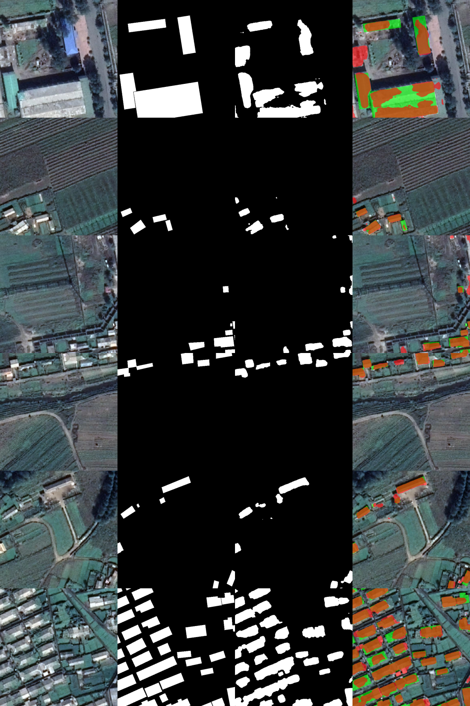

# RS_UNet — 遥感影像建筑物提取

[](https://github.com/zbf1154-ctrl/Building-Semantic-Segmentation-of-Remote-Sensing-Imagery-with-UNet/actions/workflows/ci.yml)


从零实现的 UNet 二分类语义分割工程：输入 512×512 遥感影像切片，输出建筑物二值掩膜。
不依赖 `segmentation-models-pytorch` 等第三方分割库，全部代码可读可改。

训练集 700 / 验证集 200 / 测试集 100 张。**单卡 RTX 5060 Laptop（8 GB）43 分钟训练，test IoU 61.1 / Dice 75.9。**
数据与预训练权重见 [数据与权重下载](#数据与权重下载)；数据来源见 [数据来源与致谢](#数据来源与致谢)。



> 每行依次为：原图 | 真值 | 预测 | 叠加（绿=真值，红=预测，橙褐=重合）。

## 特性

- **任意尺寸输入**：网络前向自动补齐到 16 的倍数再裁回，非 16 倍数边长不会崩溃
- **GPU 训练**：bf16 混合精度 + `channels_last`，8 GB 显存跑 batch=8
- **数据增强**：翻转、90° 旋转、缩放裁剪、亮度对比度、高斯噪声
- **完整评估**：IoU / Dice / F1 / Precision / Recall / 像素准确率 + 逐图指标 + 阈值扫描
- **可复现**：全流程固定随机种子，输出 `history.csv` / `summary.json` / `train.log`
- **工程化**：数据体检脚本、性能剖析脚本、单元测试、GitHub Actions CI

## 结果

**训练（seed=42，40 轮，43.2 分钟，最佳 epoch 38）**

| 指标 | val |
|---|---|
| IoU | 0.6225 |
| Dice / F1 | 0.7673 |
| Precision | 0.7571 |
| Recall | 0.7778 |
| 像素准确率 | 0.9692 |

**测试集（100 张，阈值 0.5）**

| 指标 | 数值 |
|---|---|
| **IoU** | **0.6112** |
| **Dice / F1** | **0.7587** |
| Precision | 0.7314 |
| Recall | 0.7880 |
| 像素准确率 | 0.9536 |
| 逐图 IoU 均值 / 中位数 | 0.6446 / 0.6869 |

训练曲线：epoch 1 IoU 0.365 → 7 轮 0.498 → 18 轮 0.560 → 28 轮 0.609 → 38 轮 0.6225。

## 目录结构

```
RS_UNet/
├── unet.py              # UNet 网络（支持任意尺寸输入）
├── dataset.py           # 数据集 + 在线增强
├── train.py             # GPU 训练（AMP / AdamW / 余弦退火 / 早停）
├── evaluate.py          # 测试集评估 + 阈值扫描 + 可视化
├── predict.py           # 批量推理
├── tools/
│   ├── probe_data.py    # 数据体检（尺寸/通道/位深/掩膜取值）
│   └── bench.py         # 性能剖析（数据加载 vs GPU 单步）
├── tests/test_model.py  # 单元测试
├── samples/             # 少量示例影像与掩膜
├── assets/              # README 用图
└── data/                # 训练数据（不入库）
```

## 安装

```bash
git clone https://github.com/zbf1154-ctrl/Building-Semantic-Segmentation-of-Remote-Sensing-Imagery-with-UNet.git
cd RS_UNet
python -m venv .venv
# Windows: .venv\Scripts\activate    Linux/macOS: source .venv/bin/activate
pip install -r requirements.txt
```

GPU 版 PyTorch 需按驱动选择 CUDA 版本，例如：

```bash
pip install torch --index-url https://download.pytorch.org/whl/cu132
```

## 数据与权重下载

训练数据（1000 张 512×512 切片，761 MB）与预训练权重（`best.pt`，124 MB）已打包放在百度网盘：

- **链接**：https://pan.baidu.com/s/13bZBmqeMB4SH7vg_kDuuIQ?pwd=ubrw
- **提取码**：`ubrw`
- **文件**：`data&weights.rar`

解压后按如下方式放置即可直接复现结果：

```
RS_UNet/
├── data/                ← 解压得到的 6 个目录（train/val/test 的 images 与 masks）
└── runs/unet/best.pt    ← 权重放到这里；也可用 --weights 指定任意路径
```

然后直接评估或推理，无需重新训练：

```bash
python evaluate.py --weights runs/unet/best.pt --split test --vis 6
python predict.py --input data/test_images --weights runs/unet/best.pt --output preds/test --overlay
```

> 百度网盘对海外用户不友好，链接也可能失效；若无法访问，可按下一节从 WHU 官方渠道自行获取原始数据。
> 代码本身不依赖网盘，网盘只用于分发数据与权重。

## 数据来源与致谢

本项目使用的遥感影像与建筑标签来自 **WHU Building Dataset**（武汉大学 GPCV 课题组）：

- 官方主页：<https://gpcv.whu.edu.cn/data/building_dataset.html>
- 本仓库使用的是其 **0.3 m 分辨率航空影像的 512×512 切片子集**，共 1000 张，
  并按 **700 / 200 / 100** 重新划分训练/验证/测试集。
  注意：这与官方原始划分（4736 / 1036 / 2416）不同，指标不能直接与 WHU 论文中的数字对比。
- **数据版权归武汉大学 GPCV Lab 所有，本项目不主张任何数据权利。**
  WHU 官方页面未给出明确的开源许可证（学术界通常按"仅限研究用途"理解），
  商业使用请先联系数据方：`jishunping@whu.edu.cn`。

若在论文或公开成果中使用，请引用：

```bibtex
@article{ji2019fully,
  title   = {Fully Convolutional Networks for Multisource Building Extraction
             From an Open Aerial and Satellite Imagery Data Set},
  author  = {Ji, Shunping and Wei, Shiqing and Lu, Meng},
  journal = {IEEE Transactions on Geoscience and Remote Sensing},
  volume  = {57},
  number  = {1},
  pages   = {574--586},
  year    = {2019},
  doi     = {10.1109/TGRS.2018.2858817}
}
```

## 数据准备（自行获取时）

若不想用网盘，可从 WHU 官方主页下载 "1.1 The cropped aerial image tiles and raster labels"（0.3 m），
再自行切片与划分。本仓库只提供 `samples/` 下的两张示例图。

请按如下结构组织数据，影像与掩膜**同名一一对应**：

```
data/
├── train_images/  *.tif      train_masks/  *.tif
├── val_images/    *.tif      val_masks/    *.tif
└── test_images/   *.tif      test_masks/   *.tif
```

要求：

- 影像为 3 通道（或单通道/4 通道，代码会自动转 RGB），uint8 或 uint16
- 掩膜为单通道灰度，建筑物取 255（或 1），背景 0
- 影像与掩膜尺寸需一致；训练时会统一 resize 到 `--image-size`
- 命名任意，但影像与掩膜的**文件名必须相同**

准备好后先体检一遍，确认没有缺配或尺寸异常：

```bash
python tools/probe_data.py
```

## 使用

```bash
# 训练（检测不到 CUDA 会直接报错退出，不会静默退回 CPU）
python train.py --epochs 40 --batch-size 8 --workers 4

# 在测试集上评估
python evaluate.py --weights runs/unet/best.pt --split test --vis 6

# 批量推理
python predict.py --input data/test_images --weights runs/unet/best.pt --output preds/test --overlay
```

主要参数：

| 参数 | 默认值 | 说明 |
|---|---|---|
| `--epochs` | 60 | 最大轮数，`--patience` 默认 15 轮早停 |
| `--batch-size` | 8 | 512² 下 8 GB 显存的安全上限（batch=12 会爆显存） |
| `--lr` / `--min-lr` | 1e-3 / 1e-5 | AdamW + 余弦退火，前 `--warmup-epochs` 轮预热 |
| `--workers` | 4 | DataLoader 进程数；受限环境（无法创建命名管道）设为 0 |
| `--image-size` | 512 | 训练/推理分辨率 |
| `--no-amp` | 关 | 关闭 bf16 混合精度 |
| `--cache` | 关 | 影像常驻内存省解码，但长跑会因内存压力变慢，见下文 |

产物默认写入 `runs/unet/`：

| 文件 | 说明 |
|---|---|
| `best.pt` | 按验证 IoU 保存的最佳权重（约 124 MB） |
| `train.log` | 完整训练日志（每轮耗时、显存） |
| `history.csv` | 逐轮 loss / IoU / Dice / P / R / Acc / lr |
| `summary.json` | 最佳轮次与指标汇总 |
| `eval/metrics.json` | 测试集指标 + 阈值扫描 |
| `eval/per_image.csv` | 每张图的 IoU / Dice / P / R |
| `eval/visual_grid.png` | 四联对比图 |

## 实现要点

- **网络**：标准 5 级 UNet（`DoubleConv` = Conv3×3-BN-ReLU ×2），4 次池化 + 转置卷积上采样 + 跳跃连接，
  约 31.04 M 参数。输出为 **logits**，训练用 `BCEWithLogitsLoss`，推理时才做 sigmoid。
- **损失**：`0.6 × BCE + 0.4 × Dice`，兼顾像素级与区域级。
- **尺寸约束**：4 次池化要求边长是 16 的倍数，已在 `UNet.forward` 内部用 `replicate` 填充解决。
- **指标**：在验证集上累计 TP/FP/FN/TN 后一次性计算，而非逐 batch 平均，避免小 batch 偏差。

## 性能与踩坑记录（RTX 5060 Laptop 8 GB）

| 项目 | 数值 |
|---|---|
| 单步耗时（batch=8, 512², bf16） | ~0.55 s |
| 单轮耗时（87 步训练 + 25 步验证） | ~64 s |
| 峰值显存 | 6.56 GB |
| 数据加载（含增强，单进程） | ~14 ms/样本 |
| batch=12 | 9.2 GB → 超显存，严重降速，不可用 |

三个实测结论，帮后来者避坑：

1. **batch=12 会爆显存**：8 GB 卡上 batch=8 是上限，超了之后不是报错而是掉进共享内存，
   单步从 0.44 s 恶化到 11.9 s。
2. **不要设 `PYTORCH_CUDA_ALLOC_CONF=expandable_segments:True`**：该平台不支持，
   设置后单步退化到秒级。
3. **`--cache` 有反作用**：短跑能省约 10 s/轮，但长跑约 10 轮后会因系统内存压力导致整机变慢
   （单轮 55 s → 300 s），默认关闭。

## 已知限制

- 大体量厂房/长条屋顶容易**欠分割**（见对比图第一行），小目标表现更好；
  可尝试多尺度训练、Dice+Focal 损失、TTA 或模型集成。
- 未做测试时增强（TTA）与集成，通常还能再涨 1–3 个 IoU 点。
- 只支持二分类（建筑/背景），多类别需改 `out_channels` 与损失。

## 许可证

- **代码与训练权重**：采用 [MIT License](LICENSE)。
- **数据（`data/`、`samples/`、`assets/` 中的影像与标签）**：版权归 **武汉大学 GPCV Lab** 所有，
  **不随 MIT 授权**，使用请遵循 [WHU Building Dataset](https://gpcv.whu.edu.cn/data/building_dataset.html)
  的条款并引用其论文，详见上文「数据来源与致谢」。
